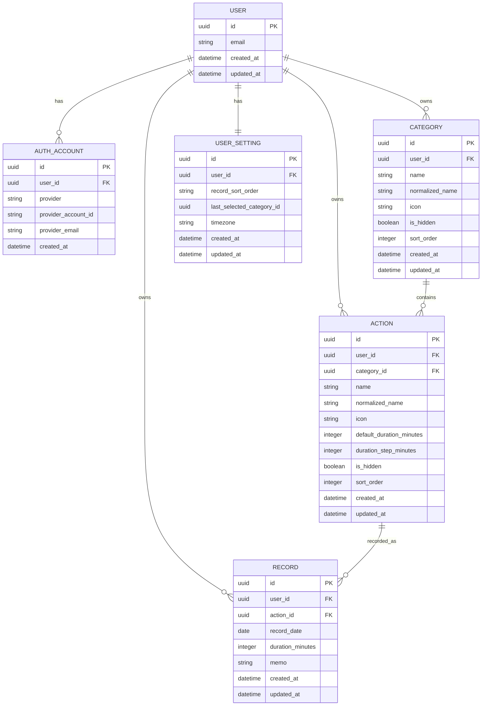

# 행동 기록 앱 DB 설계서 V1.1

> 기준 환경: PostgreSQL (Supabase) + Prisma ORM
>
> 기준 문서: 행동 기록 앱 화면정의서 V2, 기능명세서 V1.1 (`docs/feature-spec.md`)
>
> 설계 원칙: MVP 구현에 필요한 최소 구조를 사용하되 향후 기능 확장이 가능하도록 한다.
>
> V1.1 변경 근거: `docs/decisions.md`

---

# 0. 문서 개요

## 0-1. 변경 이력

| 버전 | 작성일 | 변경 내용 |
| --- | --- | --- |
| V1.0 | 2026.07 | 초안 작성 (6-6 sort_order 정책은 2026.07.22 추가) |
| V1.1 | 2026.11.03 | User.id를 Supabase Auth id로 사용, 시간 1분 단위(1~1439), actions.duration_step_minutes 추가, Check 제약 범위 변경, 구현 전 확인 사항 일부 확정 |

## 0-2. 목적

이 문서는 행동 기록 앱의 데이터를 어떤 테이블과 컬럼으로 저장하고, 테이블 간 관계와 데이터 무결성을 어떻게 관리할지 정의한다.

주요 목적은 다음과 같다.

- 사용자별 데이터 분리
- 카테고리와 행동의 숨김 상태 관리
- 행동 기록의 반복 생성
- 날짜별·행동별 기록 조회
- 행동명 및 카테고리 변경 시 과거 기록에 현재 정보 반영
- 동일 이름 중복 방지
- 회원 탈퇴 시 사용자 데이터 삭제
- 향후 통계 및 기록 시간 기능 확장

---

# 1. 설계 전제

## 1-1. 데이터베이스

PostgreSQL을 기준으로 한다. 운영 DB는 Supabase를 사용한다.

## 1-2. ORM

Prisma ORM 사용을 기준으로 한다.

## 1-3. ID 형식

모든 주요 테이블의 기본키는 UUID를 사용한다.

```
id UUID
```

UUID를 사용하는 이유는 다음과 같다.

- API에서 순차적인 데이터 개수를 노출하지 않는다.
- 여러 환경에서 ID 충돌 가능성이 낮다.
- 추후 분산 환경이나 데이터 이전에 유리하다.

`users.id`는 직접 생성하지 않고 Supabase Auth의 `auth.users.id`를 그대로 사용한다. (V1.1, 4-3 참고)

## 1-4. 명명 규칙

### Prisma 모델

PascalCase를 사용한다.

```
User
Category
Action
Record
UserSetting
```

### DB 테이블 및 컬럼

snake_case를 사용한다.

```
users
categories
actions
records
user_settings
```

Prisma의 `@@map`, `@map`을 사용해 연결한다.

> V1.1 메모: 현재 코드는 아직 PascalCase 테이블명을 사용한다. Supabase 이전 전에 `@@map`/`@map`을 적용한다.

---

# 2. 전체 테이블 목록

| 테이블 | 역할 |
| --- | --- |
| `users` | 앱 사용자 계정 |
| `auth_accounts` | Google·Apple 로그인 계정 정보 |
| `categories` | 사용자가 생성한 카테고리 |
| `actions` | 카테고리에 속한 행동 |
| `records` | 사용자가 실제로 수행한 행동 기록 |
| `user_settings` | 사용자별 앱 설정 |

MVP의 핵심 테이블은 총 6개다.

`auth_accounts`의 유지 여부는 인증 단계에서 다시 검토한다. (5-5 참고)

---

# 3. ERD

## 3-1. 관계 구조

```
User
 ├── 1:N ── AuthAccount
 ├── 1:N ── Category
 ├── 1:N ── Action
 ├── 1:N ── Record
 └── 1:1 ── UserSetting

Category
 └── 1:N ── Action

Action
 └── 1:N ── Record
```

## 3-2. Mermaid ERD



---

# 4. users 테이블

## 4-1. 역할

앱 사용자 자체를 나타낸다.

Google 또는 Apple 로그인 정보는 `auth_accounts`에서 별도로 관리한다.

## 4-2. 컬럼 정의

| 컬럼 | 타입 | Null | 기본값 | 설명 |
| --- | --- | --- | --- | --- |
| `id` | UUID | X | 없음 (Supabase Auth id) | 사용자 ID |
| `email` | VARCHAR(320) | O |  | 대표 이메일 (UNIQUE 아님) |
| `created_at` | TIMESTAMPTZ | X | 현재 시각 | 가입 시각 |
| `updated_at` | TIMESTAMPTZ | X | 현재 시각 | 마지막 수정 시각 |

## 4-3. 설계 규칙

- `id`는 Supabase Auth의 `auth.users.id`를 그대로 저장한다. (V1.1)
  - 인증 토큰에서 꺼낸 사용자 id가 곧 `userId`가 된다.
  - RLS를 사용할 경우 `auth.uid() = user_id` 형태로 작성할 수 있다.
- Google과 Apple의 이메일이 같아도 자동으로 같은 사용자로 합치지 않는다.
- 이메일은 화면 표시용 또는 연락 정보로 사용할 수 있다.
- 이메일은 null을 허용하고 UNIQUE 제약을 두지 않는다. (V1.1)
  - Apple은 첫 로그인 때만 이메일을 제공할 수 있다.
  - 같은 이메일의 Google·Apple 계정을 독립 사용자로 둘 수 있어야 한다.
- 실제 로그인 계정 식별에는 이메일이 아니라 `provider + provider_account_id` 조합(또는 Supabase Auth id)을 사용한다.
- Apple 이메일 가리기를 사용하는 경우 중계 이메일을 저장할 수 있다.
- 이메일을 계정 통합의 기준으로 사용하지 않는다.

> V1.1 메모: 현재 코드는 `email`이 `NOT NULL` + `UNIQUE`다. 스키마 정리 단계에서 변경한다.

## 4-4. 삭제 정책

회원 탈퇴 시 사용자와 연결된 서비스 데이터를 함께 삭제한다.

```
User 삭제
→ AuthAccount 삭제
→ Category 삭제
→ Action 삭제
→ Record 삭제
→ UserSetting 삭제
```

실제 구현에서는 하나의 트랜잭션 또는 안전한 탈퇴 처리 로직을 사용한다.

Supabase Auth 사용자(`auth.users`) 삭제도 탈퇴 처리에 포함한다.

---

# 5. auth_accounts 테이블

## 5-1. 역할

사용자의 SNS 로그인 계정을 저장한다.

현재는 사용자 한 명당 로그인 계정 한 개를 사용하지만, 나중에 계정 연결 기능을 추가할 수 있도록 별도 테이블로 분리한다.

## 5-2. 컬럼 정의

| 컬럼 | 타입 | Null | 기본값 | 설명 |
| --- | --- | --- | --- | --- |
| `id` | UUID | X | UUID 생성 | 인증 계정 ID |
| `user_id` | UUID | X |  | 사용자 ID |
| `provider` | ENUM | X |  | `GOOGLE`, `APPLE` |
| `provider_account_id` | VARCHAR(255) | X |  | SNS가 제공하는 고유 사용자 ID |
| `provider_email` | VARCHAR(320) | O |  | SNS에서 제공받은 이메일 |
| `created_at` | TIMESTAMPTZ | X | 현재 시각 | 생성 시각 |

`updated_at`은 두지 않는다.

## 5-3. Unique 제약

```
UNIQUE(provider, provider_account_id)
```

같은 Google 또는 Apple 계정으로 앱 사용자가 중복 생성되는 것을 방지한다.

## 5-4. 관계

```
AuthAccount N : 1 User
```

현재 MVP에서는 한 사용자에게 인증 계정 한 개만 연결되지만, DB 구조상 여러 인증 계정을 연결할 수 있다.

실제 계정 연결 기능은 MVP에서 제공하지 않는다.

## 5-5. 유지 여부 (V1.1 추가)

User.id로 Supabase Auth id를 사용하면 provider 정보는 Supabase Auth(`auth.identities`)에도 저장된다.

인증 단계에서 다음을 확인하고 이 테이블의 유지 여부를 결정한다.

- 앱 DB에서 provider 정보를 직접 조회할 필요가 있는지
- Supabase의 자동 계정 연결(identity linking)이 "자동 계정 통합 안 함" 정책과 충돌하지 않는지

---

# 6. categories 테이블

## 6-1. 역할

사용자가 행동을 분류하기 위해 생성한 카테고리를 저장한다.

예:

- 일상
- 운동
- 커리어
- 취미

## 6-2. 컬럼 정의

| 컬럼 | 타입 | Null | 기본값 | 설명 |
| --- | --- | --- | --- | --- |
| `id` | UUID | X | UUID 생성 | 카테고리 ID |
| `user_id` | UUID | X |  | 소유 사용자 |
| `name` | VARCHAR(15) | X |  | 화면에 표시할 이름 |
| `normalized_name` | VARCHAR(15) | X |  | 중복 비교용 이름 |
| `icon` | VARCHAR(100) | X | 기본 아이콘 | 아이콘 식별값 |
| `is_hidden` | BOOLEAN | X | `false` | 숨김 여부 |
| `sort_order` | INTEGER | X |  | 표시 순서 |
| `created_at` | TIMESTAMPTZ | X | 현재 시각 | 생성 시각 |
| `updated_at` | TIMESTAMPTZ | X | 현재 시각 | 수정 시각 |

## 6-3. normalized_name

`normalized_name`은 이름 중복 검사를 위한 값이다.

예:

```
입력값: " 운동 "
저장 name: "운동"
저장 normalized_name: "운동"
```

영문 이름인 경우 대소문자를 통일한다.

```
입력값: "Health"
normalized_name: "health"
```

내부 공백은 유지한다.

```
"자기 계발" → "자기 계발"
"자기계발"   → "자기계발"
```

두 값은 서로 다른 이름이다.

## 6-4. Unique 제약

```
UNIQUE(user_id, normalized_name)
```

활성 여부와 관계없이 같은 사용자가 동일한 카테고리명을 중복 생성하지 못하게 한다.

따라서 같은 이름의 숨긴 카테고리가 있으면 새로 만들지 않고 기존 카테고리 재활성화를 안내한다.

## 6-5. 숨김 정책

카테고리는 영구 삭제하지 않는다.

```
is_hidden = true
```

카테고리를 숨길 때 하위 행동의 `is_hidden` 값은 변경하지 않는다.

예:

```
운동 카테고리: hidden
러닝 행동: active
스트레칭 행동: hidden
```

카테고리를 다시 활성화하면:

- 러닝은 다시 표시
- 스트레칭은 계속 숨김

## 6-6. sort_order

sort_order는 사용자별 카테고리 표시 순서를 나타낸다. (2026.07.22 변경)

최초 카테고리는 100으로 저장하고, 이후 생성되는 카테고리는 현재 사용자의 최대 sort_order + 100으로 저장한다.

카테고리 조회 시 sort_order 오름차순으로 정렬하며, 동일한 sort_order가 존재하는 경우 created_at 오름차순을 보조 정렬 기준으로 사용한다.

카테고리를 숨기거나 다시 활성화해도 기존 sort_order를 유지한다.

향후 순서 변경 기능이 추가되면 이동할 위치의 앞뒤 sort_order 중간값을 저장한다. 두 값 사이에 정수 간격이 없는 경우 전체 카테고리의 sort_order를 100 단위로 재배치한다.

## 6-7. 삭제 정책

회원 탈퇴가 아닌 일반 사용 흐름에서는 삭제하지 않는다.

회원 탈퇴로 사용자가 삭제되는 경우에만 카테고리를 함께 삭제한다.

---

# 7. actions 테이블

## 7-1. 역할

카테고리에 속하는 행동을 저장한다.

예:

```
운동
- 러닝
- 스트레칭
```

## 7-2. 컬럼 정의

| 컬럼 | 타입 | Null | 기본값 | 설명 |
| --- | --- | --- | --- | --- |
| `id` | UUID | X | UUID 생성 | 행동 ID |
| `user_id` | UUID | X |  | 소유 사용자 |
| `category_id` | UUID | X |  | 소속 카테고리 |
| `name` | VARCHAR(15) | X |  | 행동명 |
| `normalized_name` | VARCHAR(15) | X |  | 중복 비교용 행동명 |
| `icon` | VARCHAR(100) | X | 기본 아이콘 | 행동 아이콘 |
| `default_duration_minutes` | SMALLINT | O | `null` | 기본 소요 시간 |
| `duration_step_minutes` | SMALLINT | X | `5` | ± 버튼 조정 단위 (V1.1 추가) |
| `is_hidden` | BOOLEAN | X | `false` | 개별 숨김 여부 |
| `sort_order` | INTEGER | X |  | 카테고리 내 순서 |
| `created_at` | TIMESTAMPTZ | X | 현재 시각 | 생성 시각 |
| `updated_at` | TIMESTAMPTZ | X | 현재 시각 | 수정 시각 |

## 7-3. Unique 제약

```
UNIQUE(category_id, normalized_name)
```

같은 카테고리 안에서는 같은 이름의 행동을 생성할 수 없다.

```
운동
- 산책
- 산책
```

불가.

다른 카테고리에서는 허용한다.

```
일상
- 산책

운동
- 산책
```

가능.

`user_id`는 소유권 검증과 조회 편의를 위해 행동에도 직접 저장한다.

## 7-4. 기본 시간 (V1.1 변경)

`default_duration_minutes`에는 총 분을 저장한다.

```
30분      → 30
1시간     → 60
1시간 30분 → 90
```

시간 없음은 `null`로 저장한다. (예: 알약 먹기)

### 허용 범위

```
null
또는
1~1439
```

1분 단위 정수를 허용한다.

이 검증은 서버에서 반드시 수행하고, DB Check 제약으로 한 번 더 막는다. (15장)

## 7-5. ± 단위 (V1.1 추가)

`duration_step_minutes`는 기록 입력 시트와 기록 편집에서 ± 버튼이 바꾸는 시간 폭이다.

### 허용값

```
1, 5, 10, 15, 30, 60
```

기본값은 `5`다.

기록 데이터에는 영향을 주지 않으며, 화면 입력 편의를 위한 값이다.

## 7-6. 카테고리 이동

행동의 카테고리를 이동할 때 `category_id`를 변경한다.

기록은 `action_id`만 참조하므로 기존 기록 데이터는 수정하지 않는다.

예:

```
러닝
category_id: 운동
```

에서

```
러닝
category_id: 취미
```

로 변경하면 과거 기록도 현재 카테고리인 `취미` 아래에 표시된다.

### 이동 제한

- 숨긴 카테고리로 이동할 수 없다.
- 이동 대상 카테고리에 동일한 `normalized_name`이 있으면 이동할 수 없다.

## 7-7. 이름·아이콘 변경

기존 Record에는 행동명이나 아이콘 스냅샷을 저장하지 않는다.

따라서 행동의 이름이나 아이콘을 변경하면 모든 과거 기록에서 현재 행동 정보가 표시된다.

## 7-8. 숨김 정책

```
is_hidden = true
```

숨긴 행동은:

- 홈 행동 목록에서 제외
- 신규 기록 대상에서 제외
- 과거 기록에서는 표시
- 기존 기록 수정·삭제 가능

## 7-9. sort_order

카테고리 안에서 생성 순서를 저장한다.

최초 행동은 1로 저장하고, 이후 생성되는 행동은 해당 카테고리의 최대 sort_order + 1로 저장한다. 동일한 sort_order가 존재하는 경우 created_at 오름차순을 보조 정렬 기준으로 사용한다.

행동을 다른 카테고리로 이동할 경우 대상 카테고리의 마지막 순서로 이동시키는 것을 기본 구현으로 권장한다.

다만 과거 생성 순서를 전역적으로 유지하고 싶다면 별도 순서 정책으로 변경할 수 있다.

MVP에서는 다음 방식이 단순하다.

```
카테고리 이동
→ 대상 카테고리의 max(sort_order) + 1
```

---

# 8. records 테이블

## 8-1. 역할

사용자가 실제로 수행한 행동 한 건을 저장한다.

같은 날짜에 같은 행동을 여러 번 기록하면 Record가 여러 개 생성된다.

## 8-2. 컬럼 정의

| 컬럼 | 타입 | Null | 기본값 | 설명 |
| --- | --- | --- | --- | --- |
| `id` | UUID | X | UUID 생성 | 기록 ID |
| `user_id` | UUID | X |  | 소유 사용자 |
| `action_id` | UUID | X |  | 기록한 행동 |
| `record_date` | DATE | X |  | 행동을 수행한 날짜 |
| `duration_minutes` | SMALLINT | O | `null` | 소요 시간 |
| `memo` | VARCHAR(500) | O | `null` | 메모 |
| `created_at` | TIMESTAMPTZ | X | 현재 시각 | 기록 생성 시각 |
| `updated_at` | TIMESTAMPTZ | X | 현재 시각 | 마지막 수정 시각 |

## 8-3. 반복 기록

다음과 같은 Unique 제약은 만들지 않는다.

```
UNIQUE(action_id, record_date)
```

같은 날짜와 행동으로 여러 Record를 생성할 수 있어야 하기 때문이다.

예:

```
2026-07-15 러닝 30분
2026-07-15 러닝 20분
2026-07-15 러닝 시간 없음
```

총 3개의 독립된 Record로 저장한다.

탭 즉시 기록도 매번 새 Record를 생성한다.

## 8-4. record_date

`record_date`는 PostgreSQL `DATE` 타입을 사용한다.

```
2026-07-15
```

시각이나 시간대를 포함하지 않는다.

다음 데이터와 구분한다.

```
record_date → 사용자가 수행한 날짜
created_at  → 서버에 실제 저장한 시각
updated_at  → 마지막으로 수정한 시각
```

사용자가 다른 시간대로 이동해도 기존 `record_date`는 변경하지 않는다.

## 8-5. duration_minutes (V1.1 변경)

총 분 단위로 저장한다.

시간이 없는 기록은 `null`이다.

### Validation

```
duration_minutes IS NULL
또는
duration_minutes BETWEEN 1 AND 1439
```

`0`은 저장하지 않는다.

사용자가 휠 피커나 ± 버튼으로 `0시간 0분`을 만들면 `null`로 변환한다.

## 8-6. memo

- 최대 500자
- 앞뒤 공백 제거
- 내부 줄바꿈 유지
- 내부 공백 유지
- 공백만 입력한 경우 `null`

예:

```
"  아침 러닝\n한강에서  "
```

저장:

```
"아침 러닝\n한강에서"
```

## 8-7. 행동 정보 스냅샷 미사용

다음 컬럼은 Record에 저장하지 않는다.

```
action_name
action_icon
category_id
category_name
```

Record는 `action_id`를 통해 현재 행동과 카테고리 정보를 조회한다.

### 장점

- 행동명 변경이 과거 기록에 자동 반영
- 아이콘 변경이 과거 기록에 자동 반영
- 카테고리 이동이 과거 기록에 자동 반영
- 중복 데이터 감소

### 단점

예전에 행동 이름이 무엇이었는지 확인할 수 없다.

현재 앱 정책에서는 과거 이름 이력이 필요하지 않으므로 스냅샷을 사용하지 않는다.

## 8-8. 수정

수정 가능한 값:

- `record_date`
- `duration_minutes`
- `memo`

수정할 수 없는 값:

- `id`
- `user_id`
- `action_id`
- `created_at`

수정 시 `updated_at`만 갱신한다.

## 8-9. 삭제

행동 기록은 실제 삭제한다.

```
DELETE FROM records WHERE id = ...
```

휴지통이나 `is_deleted` 필드는 MVP에서 사용하지 않는다.

토스트의 `되돌리기`도 같은 실제 삭제로 처리한다.

삭제 후 복구할 수 없다.

## 8-10. 정렬

기본 정렬:

```
ORDER BY created_at DESC
```

사용자가 오래된 기록 먼저를 선택한 경우:

```
ORDER BY created_at ASC
```

`updated_at`은 정렬 기준으로 사용하지 않는다.

---

# 9. user_settings 테이블

## 9-1. 역할

사용자별 앱 설정과 일부 UI 복원 상태를 저장한다.

## 9-2. 컬럼 정의

| 컬럼 | 타입 | Null | 기본값 | 설명 |
| --- | --- | --- | --- | --- |
| `id` | UUID | X | UUID 생성 | 설정 ID |
| `user_id` | UUID | X |  | 사용자 ID |
| `record_sort_order` | ENUM | X | `NEWEST_FIRST` | 기록 정렬 |
| `last_selected_category_id` | UUID | O | `null` | 마지막 선택 카테고리 |
| `timezone` | VARCHAR(100) | O | `null` | 최근 확인된 IANA 시간대 |
| `created_at` | TIMESTAMPTZ | X | 현재 시각 | 생성 시각 |
| `updated_at` | TIMESTAMPTZ | X | 현재 시각 | 수정 시각 |

## 9-3. Unique 제약

```
UNIQUE(user_id)
```

사용자 한 명당 설정 데이터는 한 건만 가진다.

## 9-4. record_sort_order

ENUM 값:

```
NEWEST_FIRST
OLDEST_FIRST
```

기본값:

```
NEWEST_FIRST
```

## 9-5. last_selected_category_id

마지막으로 선택한 카테고리를 저장한다.

앱 재실행 시:

1. `last_selected_category_id`를 조회한다.
2. 해당 카테고리가 현재 활성 상태인지 검사한다.
3. 활성 상태면 선택한다.
4. 숨김 또는 존재하지 않는 경우 첫 번째 활성 카테고리를 선택한다.

외래키는 `SET NULL` 정책을 권장한다.

다만 카테고리는 일반적으로 영구 삭제되지 않으므로 회원 탈퇴 외에는 거의 발생하지 않는다.

## 9-6. timezone

예:

```
Asia/Seoul
America/New_York
```

현재 날짜 검증 또는 추후 알림 기능에 사용할 수 있다.

사용자의 현재 시간대가 변경될 수 있으므로 로그인 또는 앱 실행 시 갱신할 수 있다.

---

# 10. 외래키 및 삭제 정책

## 10-1. 관계별 정책

| 부모 | 자식 | 삭제 정책 |
| --- | --- | --- |
| User | AuthAccount | CASCADE |
| User | Category | CASCADE |
| User | Action | CASCADE |
| User | Record | CASCADE |
| User | UserSetting | CASCADE |
| Category | Action | RESTRICT |
| Action | Record | RESTRICT |
| Category | UserSetting.lastSelectedCategory | SET NULL |

## 10-2. Category → Action

카테고리는 일반 사용 흐름에서 삭제하지 않으므로 `RESTRICT`를 권장한다.

실수로 카테고리가 삭제되어 하위 행동까지 함께 사라지는 것을 막는다.

회원 탈퇴에서는 User 기준으로 데이터를 명시적으로 정리한다.

## 10-3. Action → Record

행동 역시 영구 삭제하지 않으므로 `RESTRICT`를 사용한다.

행동이 삭제되면서 과거 기록이 함께 삭제되는 사고를 방지한다.

회원 탈퇴 때는 Record를 먼저 삭제한 뒤 Action을 삭제하거나, 사용자 단위 탈퇴 트랜잭션으로 처리한다.

---

# 11. DB 제약과 서버 Validation

DB 제약만으로 모든 정책을 처리하지 않는다.

다음과 같이 역할을 나눈다.

## 11-1. DB에서 강제할 규칙

- PK
- FK
- 인증 계정 중복
- 카테고리명 중복
- 같은 카테고리 내 행동명 중복
- 사용자 설정 1인 1건
- Null 허용 여부
- 문자열 최대 길이
- 시간 범위 Check Constraint (1~1439)
- ± 단위 허용값 Check Constraint (1, 5, 10, 15, 30, 60)

## 11-2. 서버에서 검증할 규칙

- 미래 날짜 저장 금지
- 카테고리 최소 한 개 유지
- 숨긴 행동 신규 기록 금지
- 숨긴 카테고리의 행동 신규 기록 금지
- 숨긴 카테고리로 행동 이동 금지
- 다른 사용자 데이터 접근 금지
- 메모 trim 및 빈 문자열 `null` 변환
- 이름 정규화
- 사용자 시간대 기준 오늘 계산
- 기본 데이터 중복 생성 방지
- 시간 범위·정수 여부 (DB 제약과 동일 규칙을 서버에서도 검사)

---

# 12. 인덱스 설계

## 12-1. categories

```
INDEX(user_id, is_hidden, sort_order)
```

용도:

- 홈 활성 카테고리 조회
- 카테고리 정렬

Unique 인덱스:

```
UNIQUE(user_id, normalized_name)
```

---

## 12-2. actions

```
INDEX(user_id, category_id, is_hidden, sort_order)
```

용도:

- 선택 카테고리의 활성 행동 조회
- 행동 정렬

Unique 인덱스:

```
UNIQUE(category_id, normalized_name)
```

---

## 12-3. records

### 날짜별 기록 조회

```
INDEX(user_id, record_date)
```

### 날짜별 행동 요약

```
INDEX(user_id, record_date, action_id)
```

### 행동별 상세 기록

```
INDEX(user_id, action_id, record_date, created_at)
```

### 월간 기록 존재 날짜 조회

```
INDEX(user_id, record_date)
```

`user_id, record_date` 인덱스와 중복되는 인덱스는 실제 쿼리 성능을 확인하여 합칠 수 있다.

MVP에서는 다음 두 개로 시작해도 충분하다.

```
INDEX(user_id, record_date)
INDEX(user_id, action_id, record_date, created_at)
```

---

# 13. 주요 조회 예시

## 13-1. 홈 카테고리 조회

조건:

```
user_id = 로그인 사용자
is_hidden = false
```

정렬:

```
sort_order ASC
```

---

## 13-2. 선택 카테고리 행동 조회

조건:

```
user_id = 로그인 사용자
category_id = 선택 카테고리
is_hidden = false
카테고리도 is_hidden = false
```

정렬:

```
sort_order ASC
```

---

## 13-3. 날짜별 행동 요약

개념적 SQL:

```sql
SELECT
    action_id,
    COUNT(*) AS record_count,
    SUM(duration_minutes) AS total_duration_minutes
FROM records
WHERE user_id = :userId
  AND record_date = :recordDate
GROUP BY action_id;
```

`SUM`은 `null` 시간을 제외한다.

모든 기록의 시간이 `null`이면 애플리케이션에서 시간 표시를 생략한다.

---

## 13-4. 행동별 개별 기록 조회

```sql
SELECT *
FROM records
WHERE user_id = :userId
  AND action_id = :actionId
  AND record_date = :recordDate
ORDER BY created_at DESC;
```

사용자 설정이 오래된 기록 먼저라면 `ASC`로 변경한다.

---

## 13-5. 월간 기록 날짜 조회

```sql
SELECT DISTINCT record_date
FROM records
WHERE user_id = :userId
  AND record_date BETWEEN :monthStart AND :monthEnd;
```

숨긴 행동과 카테고리의 기록도 포함한다.

---

# 14. Prisma Schema 초안 (V1.1)

> 실제 기준은 `prisma/schema.prisma`다. 이 초안은 V1.1 결정을 반영한 목표 형태이며, 스키마 정리 단계에서 실제 스키마와 맞춘다.
> 연결 URL은 `prisma.config.ts`에서 관리한다.

```prisma
generator client {
  provider = "prisma-client"
  output   = "../app/generated/prisma"
}

datasource db {
  provider = "postgresql"
}

enum AuthProvider {
  GOOGLE
  APPLE
}

enum RecordSortOrder {
  NEWEST_FIRST
  OLDEST_FIRST
}

model User {
  id        String   @id @db.Uuid // Supabase auth.users.id
  email     String?  @db.VarChar(320)
  createdAt DateTime @default(now()) @map("created_at") @db.Timestamptz
  updatedAt DateTime @updatedAt @map("updated_at") @db.Timestamptz

  authAccounts AuthAccount[]
  categories   Category[]
  actions      Action[]
  records      Record[]
  setting      UserSetting?

  @@map("users")
}

model AuthAccount {
  id                String       @id @default(uuid()) @db.Uuid
  userId            String       @map("user_id") @db.Uuid
  provider          AuthProvider
  providerAccountId String       @map("provider_account_id") @db.VarChar(255)
  providerEmail     String?      @map("provider_email") @db.VarChar(320)
  createdAt         DateTime     @default(now()) @map("created_at") @db.Timestamptz

  user User @relation(fields: [userId], references: [id], onDelete: Cascade)

  @@unique([provider, providerAccountId])
  @@index([userId])
  @@map("auth_accounts")
}

model Category {
  id             String   @id @default(uuid()) @db.Uuid
  userId         String   @map("user_id") @db.Uuid
  name           String   @db.VarChar(15)
  normalizedName String   @map("normalized_name") @db.VarChar(15)
  icon           String   @db.VarChar(100)
  isHidden       Boolean  @default(false) @map("is_hidden")
  sortOrder      Int      @map("sort_order")
  createdAt      DateTime @default(now()) @map("created_at") @db.Timestamptz
  updatedAt      DateTime @updatedAt @map("updated_at") @db.Timestamptz

  user                  User          @relation(fields: [userId], references: [id], onDelete: Cascade)
  actions               Action[]
  selectedByUserSetting UserSetting[] @relation("LastSelectedCategory")

  @@unique([userId, normalizedName])
  @@index([userId, isHidden, sortOrder])
  @@map("categories")
}

model Action {
  id                     String   @id @default(uuid()) @db.Uuid
  userId                 String   @map("user_id") @db.Uuid
  categoryId             String   @map("category_id") @db.Uuid
  name                   String   @db.VarChar(15)
  normalizedName         String   @map("normalized_name") @db.VarChar(15)
  icon                   String   @db.VarChar(100)
  defaultDurationMinutes Int?     @map("default_duration_minutes") @db.SmallInt
  durationStepMinutes    Int      @default(5) @map("duration_step_minutes") @db.SmallInt
  isHidden               Boolean  @default(false) @map("is_hidden")
  sortOrder              Int      @map("sort_order")
  createdAt              DateTime @default(now()) @map("created_at") @db.Timestamptz
  updatedAt              DateTime @updatedAt @map("updated_at") @db.Timestamptz

  user     User     @relation(fields: [userId], references: [id], onDelete: Cascade)
  category Category @relation(fields: [categoryId], references: [id], onDelete: Restrict)
  records  Record[]

  @@unique([categoryId, normalizedName])
  @@index([userId, categoryId, isHidden, sortOrder])
  @@map("actions")
}

model Record {
  id              String   @id @default(uuid()) @db.Uuid
  userId          String   @map("user_id") @db.Uuid
  actionId        String   @map("action_id") @db.Uuid
  recordDate      DateTime @map("record_date") @db.Date
  durationMinutes Int?     @map("duration_minutes") @db.SmallInt
  memo            String?  @db.VarChar(500)
  createdAt       DateTime @default(now()) @map("created_at") @db.Timestamptz
  updatedAt       DateTime @updatedAt @map("updated_at") @db.Timestamptz

  user   User   @relation(fields: [userId], references: [id], onDelete: Cascade)
  action Action @relation(fields: [actionId], references: [id], onDelete: Restrict)

  @@index([userId, recordDate])
  @@index([userId, actionId, recordDate, createdAt])
  @@map("records")
}

model UserSetting {
  id                     String          @id @default(uuid()) @db.Uuid
  userId                 String          @unique @map("user_id") @db.Uuid
  recordSortOrder        RecordSortOrder @default(NEWEST_FIRST) @map("record_sort_order")
  lastSelectedCategoryId String?         @map("last_selected_category_id") @db.Uuid
  timezone               String?         @db.VarChar(100)
  createdAt              DateTime        @default(now()) @map("created_at") @db.Timestamptz
  updatedAt              DateTime        @updatedAt @map("updated_at") @db.Timestamptz

  user                 User      @relation(fields: [userId], references: [id], onDelete: Cascade)
  lastSelectedCategory Category? @relation("LastSelectedCategory", fields: [lastSelectedCategoryId], references: [id], onDelete: SetNull)

  @@map("user_settings")
}
```

> 현재 코드와의 차이(enum 이름, icon 기본값, 관계 이름 등)는 스키마 정리 단계에서 하나씩 확인한다. 이 초안에 맞추려고 코드를 한 번에 바꾸지 않는다.

---

# 15. Check Constraint (V1.1 변경)

Prisma Schema에서는 일부 DB Check Constraint를 직접 표현하기 어렵다.

따라서 마이그레이션 SQL에 다음 제약을 수동으로 추가한다.

## 15-1. 행동 기본 시간

```sql
ALTER TABLE actions
ADD CONSTRAINT actions_default_duration_check
CHECK (
  default_duration_minutes IS NULL
  OR default_duration_minutes BETWEEN 1 AND 1439
);
```

## 15-2. 행동 ± 단위

```sql
ALTER TABLE actions
ADD CONSTRAINT actions_duration_step_check
CHECK (duration_step_minutes IN (1, 5, 10, 15, 30, 60));
```

## 15-3. 기록 소요 시간

```sql
ALTER TABLE records
ADD CONSTRAINT records_duration_check
CHECK (
  duration_minutes IS NULL
  OR duration_minutes BETWEEN 1 AND 1439
);
```

서버에서도 같은 Validation을 수행해야 한다.

DB Check Constraint는 서버 버그나 직접 DB 접근으로 잘못된 값이 들어가는 것을 한 번 더 방지한다.

---

# 16. 기본 데이터 생성

신규 사용자 가입 시 하나의 트랜잭션 안에서 다음 데이터를 생성한다.

```
User
AuthAccount (유지 시)
UserSetting
Category 3개
Action 6개
```

## 생성 예시

```
일상
- 밥 먹기
- 청소
- 설거지

운동
- 스트레칭
- 러닝

커리어
- 회사
```

기본 행동의 `default_duration_minutes`는 `null`, `duration_step_minutes`는 `5`로 생성한다.

## 처리 원칙

- 전체 생성 성공 시 가입 완료
- 하나라도 실패하면 전체 롤백
- 재시도 시 중복 생성 방지
- 첫 번째 카테고리를 `last_selected_category_id`로 저장 가능

---

# 17. 회원 탈퇴 트랜잭션

회원 탈퇴 시 다음 순서로 삭제할 수 있다.

```
1. records
2. actions
3. categories
4. user_settings
5. auth_accounts
6. users
7. Supabase auth.users
```

또는 User의 Cascade 관계를 활용할 수 있다.

다만 Category → Action, Action → Record 관계를 `RESTRICT`로 설정하므로, 명시적으로 자식부터 삭제하는 방식을 권장한다.

개념적 처리:

```ts
await prisma.$transaction(async (tx) => {
  await tx.record.deleteMany({ where: { userId } });
  await tx.action.deleteMany({ where: { userId } });
  await tx.userSetting.deleteMany({ where: { userId } });
  await tx.category.deleteMany({ where: { userId } });
  await tx.authAccount.deleteMany({ where: { userId } });
  await tx.user.delete({ where: { id: userId } });
});
// 이후 Supabase Admin API로 auth.users 삭제
```

모든 삭제가 완료되어야 탈퇴 성공으로 응답한다.

---

# 18. 향후 확장 시 추가 가능한 컬럼

현재 MVP에서는 만들지 않지만, 나중에 다음 기능을 추가할 수 있다.

## 18-1. 행동 시작·종료 시각

`records` 테이블에 추가:

```
started_at TIMESTAMPTZ NULL
ended_at TIMESTAMPTZ NULL
```

현재 `duration_minutes` 구조를 유지한 채 확장할 수 있다.

## 18-2. 행동명 변경 이력

새 테이블:

```
action_histories
```

현재 정책에서는 필요하지 않다.

## 18-3. 기록 휴지통

`records`에 추가:

```
deleted_at TIMESTAMPTZ NULL
```

현재 MVP는 실제 삭제이므로 사용하지 않는다.

## 18-4. 통계 최적화

사용량이 커지면 집계 테이블 또는 캐시를 추가할 수 있다.

```
daily_action_summaries
```

현재는 Record를 직접 집계한다.

## 18-5. 계정 연결

현재 `auth_accounts` 구조는 사용자 한 명에게 여러 SNS 계정을 연결할 수 있으므로 추가 테이블 변경 없이 확장 가능하다.

---

# 19. 설계상 핵심 결정

## 19-1. Record에 userId를 직접 저장한 이유

Record는 Action을 통해 User를 찾을 수도 있다.

```
Record → Action → User
```

그럼에도 `records.user_id`를 직접 저장한다.

이유:

- 사용자별 날짜 조회가 매우 많음
- 매번 Action 조인이 필요하지 않음
- 소유권 검증이 간단함
- 회원 탈퇴 시 사용자 데이터 삭제가 쉬움

단, Record 생성 시 반드시 다음을 검증해야 한다.

```
Record.userId === Action.userId
```

## 19-2. Action에 userId를 직접 저장한 이유

Action도 Category를 통해 User를 찾을 수 있지만 직접 저장한다.

이유:

- 사용자 소유권 검증 단순화
- 사용자별 행동 조회 효율 향상
- 탈퇴 처리 및 인덱스 구성 단순화

Action 생성·이동 시 다음을 검증한다.

```
Action.userId === Category.userId
```

## 19-3. 숨김을 날짜가 아닌 Boolean으로 둔 이유

현재 필요한 상태는 두 가지다.

```
활성
숨김
```

따라서 `is_hidden` Boolean이 가장 단순하다.

향후 보관·삭제 예정 등 여러 상태가 생기면 ENUM 또는 상태 컬럼으로 변경할 수 있다.

## 19-4. 기록 요약 테이블을 만들지 않은 이유

현재 앱 규모에서는 날짜별 Record를 직접 집계하는 것으로 충분하다.

별도 요약 테이블을 만들면:

- Record 저장과 요약 갱신의 동기화 필요
- 수정·삭제·날짜 이동 시 처리 복잡
- 데이터 불일치 위험 증가

초기에는 정확하고 단순한 직접 집계를 사용한다.

## 19-5. User.id로 Supabase Auth id를 쓰는 이유 (V1.1 추가)

- 토큰 검증 후 별도 조회 없이 `userId`를 얻을 수 있다.
- RLS 정책을 `auth.uid()` 기준으로 단순하게 작성할 수 있다.
- 대신 인증이 Supabase에 묶인다. 혼자 만드는 MVP에서는 단순함이 더 중요하다고 판단했다.

---

# 20. 구현 전 확인 사항

| # | 항목 | 상태 |
| --- | --- | --- |
| 1 | 인증 라이브러리의 기본 User·Account 테이블을 그대로 쓸지 | 결정: Supabase Auth 사용, User.id = `auth.users.id`. AuthAccount 유지 여부는 인증 단계에서 결정 |
| 2 | 아이콘 값을 이모지 문자열로 저장할지, 아이콘 코드로 저장할지 | 미정 |
| 3 | `sort_order` 생성 시 동시 요청을 어떻게 처리할지 | 결정: 별도 처리 안 함. 겹치면 `created_at` 오름차순 보조 정렬 (결정 기록 12) |
| 4 | 카테고리 이동 시 행동 `sort_order`를 대상 카테고리 마지막으로 변경할지 | 미정 (7-9 권장안) |
| 5 | Prisma 마이그레이션에 Check Constraint를 수동 추가할지 | 결정: 수동 추가 (15장) |

---

# 21. 최종 테이블 요약

```
users
- 앱 사용자 (id = Supabase Auth id)

auth_accounts
- Google·Apple 로그인 계정 (유지 여부 인증 단계에서 결정)

categories
- 행동 분류
- 사용자 내 이름 중복 불가
- 삭제 없이 숨김

actions
- 카테고리 소속 행동
- 동일 카테고리 내 이름 중복 불가
- 기본 시간 (1분 단위, null 허용)
- ± 단위 (1·5·10·15·30·60분)
- 삭제 없이 숨김

records
- 실제 수행한 행동 한 건
- 동일 날짜·행동 반복 생성 가능
- 시간과 메모 선택
- 실제 삭제 가능

user_settings
- 기록 정렬
- 마지막 선택 카테고리
- 사용자 시간대
